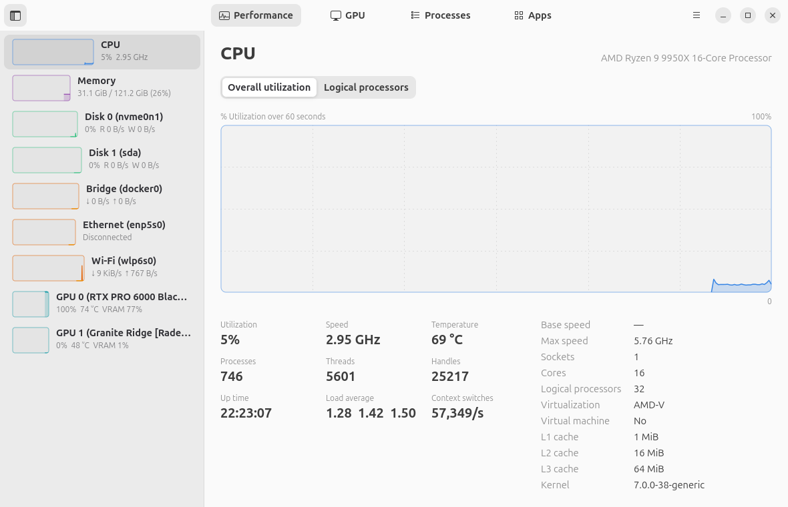
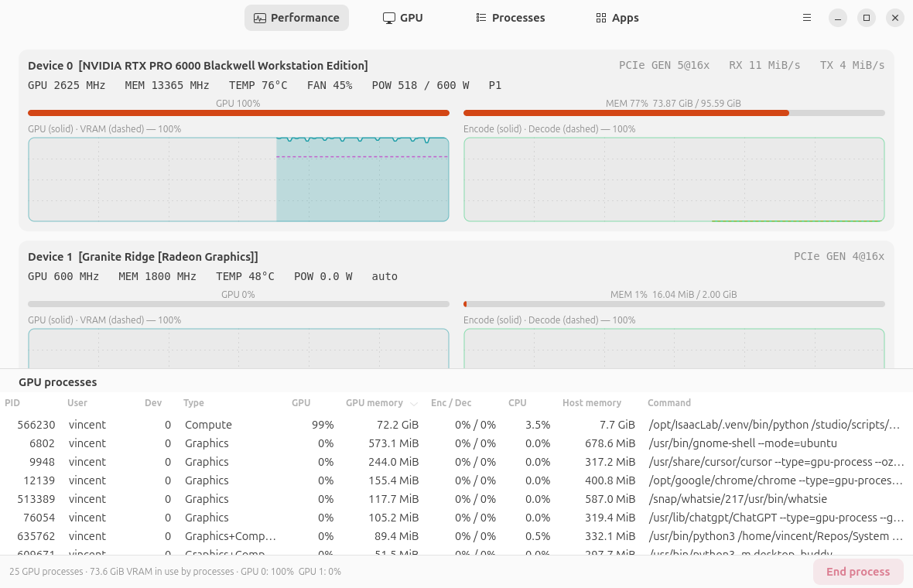
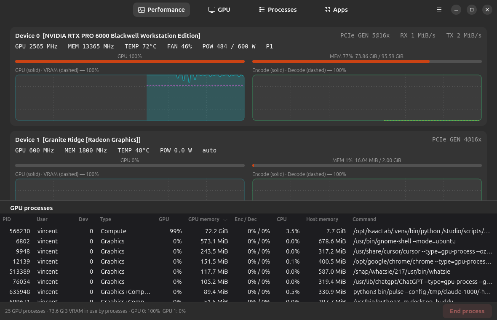
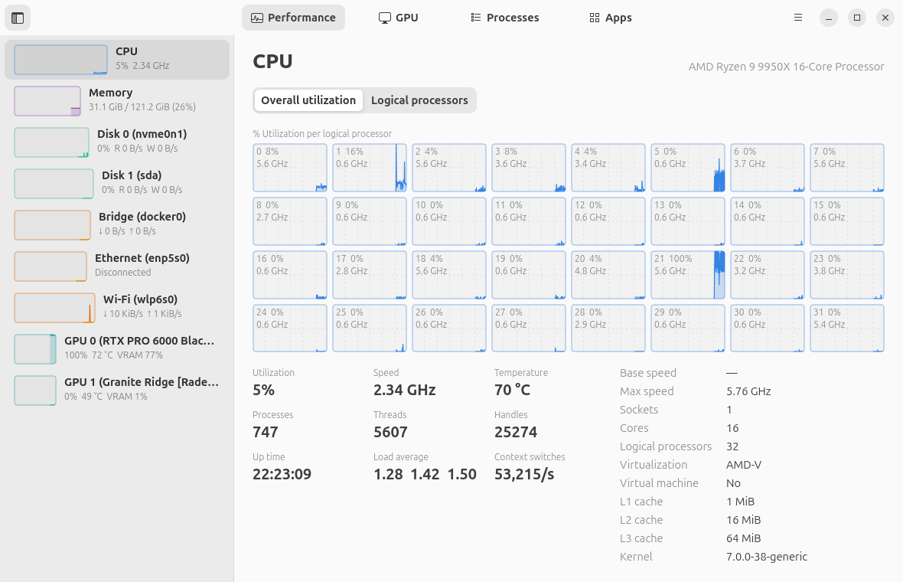
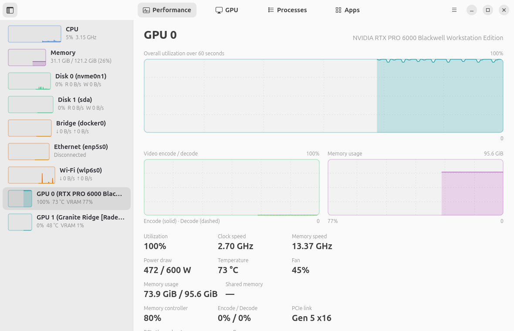
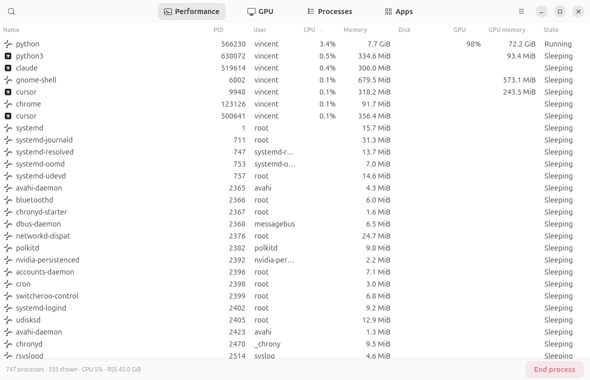
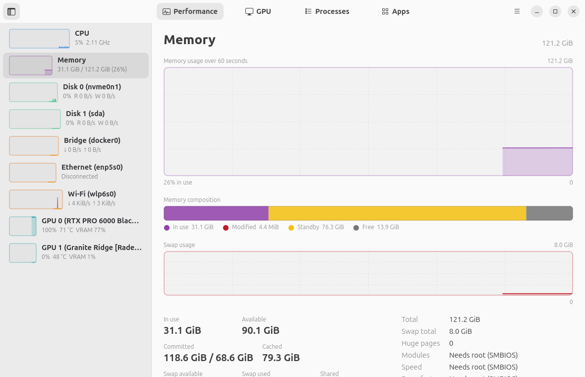
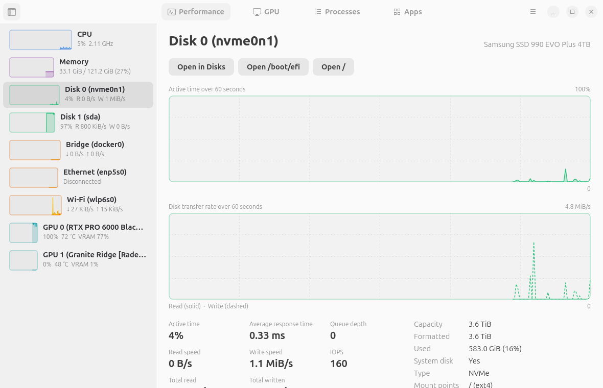
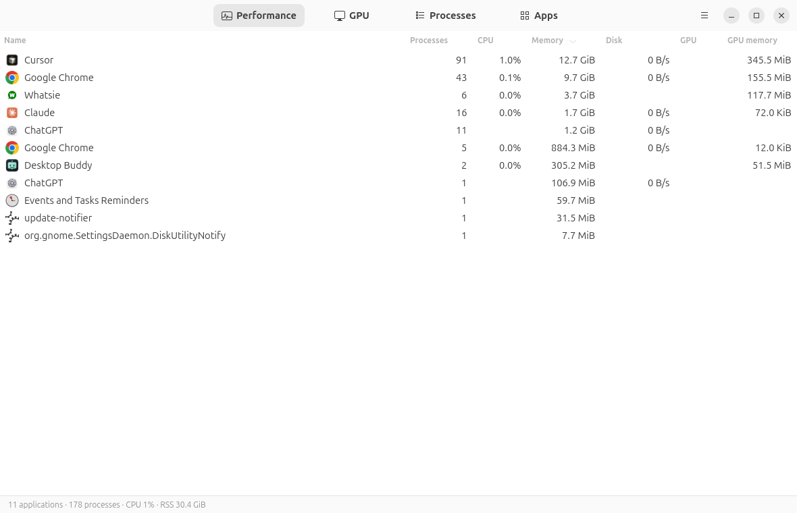

<div align="center">
  
  <h1>Pulse</h1>
  <p><strong>Mission Center and nvtop in one window.</strong></p>
  <p>A native system and GPU monitor for Linux: CPU, memory, disks, network, every GPU, and every process touching a GPU.</p>
  <p>Python · GTK 4 · libadwaita · Reads the kernel directly · No daemons, no accounts, no network</p>

  <p>
    
    
    
    
    
    
  </p>
</div>



If you run anything on a GPU, you know the routine: Mission Center for the system, a terminal
with nvtop for the GPU, and a lot of alt-tabbing to figure out which process is eating VRAM.
Pulse puts both in one GNOME app. The Performance tab is the Mission Center layout you already
know. The GPU tab is nvtop's per-process view with real widgets. Processes and Apps tabs tie it
together with disk, network and GPU columns side by side.

Everything is written from scratch and read straight from the kernel: `/proc`, `/sys`, DRM
`fdinfo`, hwmon and NVML. Nothing is bundled, nothing is shelled out to, and nothing ever
leaves your machine.

**Explore:** [Screenshots](#screenshots) · [Why Pulse](#why-pulse) · [Features](#features) ·
[Install](#install) · [Usage](#usage) · [How it works](#how-it-works) · [Testing](#testing) ·
[Limitations](#limitations) · [Contributing](#contributing)

## Screenshots

| GPU tab, nvtop style | Dark mode |
| --- | --- |
|  |  |

| All 32 logical processors | GPU page | Processes |
| --- | --- | --- |
|  |  |  |

| Memory | Disk, with mount / unmount / open | Apps |
| --- | --- | --- |
|  |  |  |

Every screenshot is produced by the test suite's screenshot tour, so they match the code.

## Why Pulse

- **One window instead of two.** System overview and per-process GPU usage in the same app, with
  the same process list. Sort by GPU % or VRAM and end the process right there.
- **Real per-process GPU numbers.** NVIDIA cards report SM, memory, encoder and decoder
  utilization per process through NVML. AMD and Intel report engine busy time and VRAM per
  process through DRM `fdinfo`. Any other DRM driver that exposes `drm-engine-*` counters works too.
- **Straight from the kernel.** No background daemon, no polling of other tools, no pynvml:
  NVML is loaded with `ctypes`. Sampling the whole machine takes about 80 ms.
- **Drives you can actually use.** Each disk page mounts, unmounts and opens volumes through
  udisks2, the same service Files uses. If an NTFS drive refuses to mount because Windows did not
  eject it cleanly, Pulse tells you why and can clear the dirty flag after a password prompt.
- **Feels like GNOME.** libadwaita widgets, light and dark themes, a responsive layout that
  collapses to a phone-width window, keyboard shortcuts for everything.
- **Tested like it matters.** 70 tests across parsers, live collectors, the sampler thread and a
  GUI tour that launches the real app, walks every view and checks the screenshots.

## Features

**Performance tab**: a sidebar with live sparklines and one page per device.

| Page | What it shows |
| --- | --- |
| CPU | overall or per-logical-processor graphs, current speed, temperature, processes, threads, handles, uptime, load average, context switches, sockets / cores / threads, virtualization, L1 / L2 / L3 cache, kernel version |
| Memory | usage graph, composition bar (in use / modified / standby / free), swap graph, committed, cached, shared, dirty, zswap, huge pages, DIMM slots and speeds when run as root |
| Disks | active time, transfer rate (read solid / write dashed), response time, queue depth, IOPS, totals, capacity, formatted / used, type (NVMe / SSD / HDD / removable), mount points; **Mount**, **Unmount** and **Open in Files** per volume, **Open in Disks** for formatting and ejecting |
| Network | throughput (receive solid / send dashed), packets, totals, errors, link state, Wi-Fi SSID / signal / frequency / bitrate, MAC, IPv4 / IPv6, driver, MTU |
| GPUs | utilization, encode / decode and VRAM graphs; core and memory clocks, power, temperature with hot spot, fan, shared memory, memory controller load, PCIe generation / width / throughput, driver, VBIOS, CUDA version, core count, performance state |

**GPU tab**: a card per GPU with the clocks / temperature / fan / power line, GPU and memory
bars, GPU + VRAM and encode / decode graphs, and a sortable table of every process touching a GPU:
PID, user, device, type (graphics or compute), GPU %, GPU memory, enc / dec, CPU %, host memory,
command. Processes can be ended from here.

**Processes tab**: sortable table with app icons, PID, user, CPU, memory, disk, GPU, GPU memory
and state. Live search, kernel-thread toggle, and a right-click menu with End / Kill / Stop /
Continue / Details behind confirmation dialogs.

**Apps tab**: processes grouped by application (systemd app scopes) with desktop names and icons,
process counts, and summed CPU / memory / disk / GPU usage.

**Supported GPUs**

| Vendor | Driver | Per-GPU | Per-process |
| --- | --- | --- | --- |
| NVIDIA | proprietary, via NVML | utilization, VRAM, clocks, power, temps, fan, PCIe, pstate | SM, memory, encoder, decoder utilization and VRAM |
| AMD | `amdgpu` | busy %, VRAM / GTT, clocks, power, temps, fan, PCIe | engine busy time and VRAM via `fdinfo` |
| Intel | `i915`, `xe` | frequency, energy-based power | engine busy time via `fdinfo` |
| Other | any DRM driver with `drm-engine-*` counters | basic | engine busy time via `fdinfo` |

## Install

Pulse needs Python 3.11+, GTK 4.14+ and libadwaita 1.7+ with GObject introspection. On Ubuntu
or Debian:

```sh
sudo apt install python3-gi gir1.2-gtk-4.0 gir1.2-adw-1
```

Optional: the NVIDIA driver (`libnvidia-ml.so.1`) for NVIDIA cards, `iw` for Wi-Fi details,
`ntfsfix` for the NTFS repair button.

```sh
git clone https://github.com/VincentAZ/pulse-monitor.git
cd pulse-monitor
./bin/pulse          # run it straight from the source tree
./install.sh         # or install for your user
```

The installer adds a `pulse` launcher to `~/.local/bin`, an entry in the app grid, a pin in the
GNOME dock and a desktop shortcut. Pass `--no-dock` or `--no-desktop` to skip the last two.
`./uninstall.sh` removes everything and keeps your settings.

## Usage

```sh
pulse                        # open the app
pulse --interval 0.5         # sample twice a second
pulse --screenshot-dir out/  # walk every view, save PNGs, exit (what the tests use)
pulse --help
```

| Shortcut | Action |
| --- | --- |
| Ctrl+1 … Ctrl+4 | Performance, GPU, Processes, Apps |
| Ctrl+F | search processes |
| Delete | end the selected process |
| F5 | sample now |
| Ctrl+, | preferences (update interval, graph window, kernel threads, virtual interfaces) |
| Ctrl+? | all shortcuts |
| Ctrl+Q | quit |

Settings live in `~/.config/pulse/settings.json`. Pulse makes no network connections and
writes nothing else.

## How it works

```
bin/pulse                   launcher
pulse/collectors/           cpu, memory, disk, network, gpu_nvidia (NVML), gpu_drm (fdinfo + sysfs), processes
pulse/sampler.py            background thread, history ring buffers, one Snapshot per tick
pulse/desktop_entries.py    .desktop index for app names and icons, cgroup -> app id
pulse/settings.py           JSON settings with validation
pulse/ui/                   GTK 4 / libadwaita UI; graphs drawn with Gsk paths
pulse/ui/udisks.py          mount / unmount over D-Bus, NTFS dirty-flag repair via pkexec
data/                       desktop entry, AppStream metainfo, icon
tests/                      unit, live and GUI tests
```

A sampler thread reads every collector once per tick (1 s by default, adjustable from 250 ms to
10 s), isolates collector failures so one broken driver never takes down the app, and hands an
immutable snapshot to the UI through the GTK main loop. Each view updates only while visible.
Graphs are drawn with GTK's own scene graph rather than cairo, so they stay crisp at any scale
and cost almost nothing to redraw.

Data sources, for the curious: `/proc/stat`, `/proc/meminfo`, `/proc/loadavg`, cpufreq and
topology sysfs, hwmon, `/sys/block/*/stat`, `/proc/self/mounts`, `/proc/net/dev`, `/proc/<pid>/
{stat,statm,io,cgroup}`, DRM `fdinfo`, `amdgpu` sysfs, NVML, SMBIOS type 17, the udev database
and the `pci.ids` file.

## Testing

```sh
./run_tests.sh
```

| Layer | What it checks |
| --- | --- |
| `tests/test_parsers.py` | every parser and formatter against synthetic input: `/proc/stat`, `/proc/meminfo`, SMBIOS, block stats, `/proc/net/dev`, `if_inet6`, `iw`, `fdinfo` for amdgpu / i915 / xe, process stat lines, cgroup scopes, udev data, udisks paths |
| `tests/test_settings.py`, `tests/test_sampler.py` | persistence, validation, ring buffers, sampler cadence, interval changes, failure isolation |
| `tests/test_collectors_live.py` | every collector on the real machine: our own PID shows CPU after burning CPU, a killed child disappears, write traffic shows up on the system disk, GPU numbers stay inside 0–100 %, volumes cover every mount |
| `tests/test_ui.py` | launches the real app, drives every view with `--screenshot-dir`, verifies each PNG is a real image and that no traceback or GTK critical occurred; in-process widget tests for the process table, apps and GPU views, settings propagation, the end-process dialog, and the disk page's mount flow against a fake udisks |

Set `PULSE_KEEP_SHOTS=/some/dir` to keep the tour's screenshots. The tour renders the window
directly through Gsk instead of waiting for compositor frames, so it works while the window is
hidden behind others.

## Limitations

- CPU base speed shows "—" on AMD, which does not expose `base_frequency` in cpufreq.
- DIMM details need root, because SMBIOS tables are root-only.
- AMD integrated GPUs often report no power draw.
- Clearing an NTFS dirty flag makes a drive readable; it does not repair it. Run `chkdsk` on
  Windows for a real repair.
- Developed and tested on Ubuntu 26.04 with GNOME on Wayland. Other GTK 4 desktops should work;
  reports welcome.

## Contributing

Issues and pull requests are welcome. Run `./run_tests.sh` before opening one; the GUI tests need
a running desktop session. If you have a GPU or driver combination that misbehaves, the output of
`cat /proc/<pid>/fdinfo/*` for a process using it is the most useful thing to attach.

## License

[MIT](LICENSE) © 2026 Vincent Serpico
